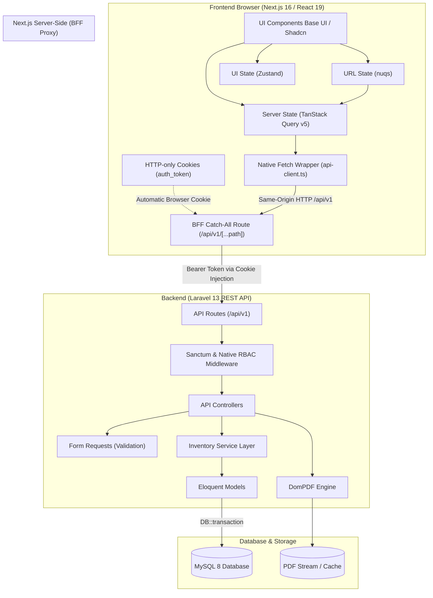

# Architecture Document

## 1. System Overview

Sistem Manajemen Inventaris Barang ini dibangun menggunakan arsitektur **Decoupled Polyrepo** yang memisahkan aplikasi ke dalam 2 repository independen:
1. **Frontend (Next.js 16 + React 19):** Single Page / Server-Client hybrid application responsif, mengelola presentasi data, routing, dan interaksi pengguna.
2. **Backend (Laravel 13):** Stateless RESTful JSON API yang mengelola otentikasi Sanctum, otorisasi RBAC (Admin & Staff), validasi bisnis, pemrosesan transaksi inventaris secara atomic, dan kompilasi laporan PDF.

---

## 2. Architecture Pattern

- **Pattern:** Decoupled Client-Server / Headless REST API Architecture.
- **Reason:**
  - Pemisahan tanggung jawab (*separation of concerns*) yang jelas antara presentasi dan logika bisnis.
  - Skalabilitas independen antara frontend UI dan backend worker/API.
  - Memanfaatkan ekosistem modern React 19 (TanStack Query, Zustand, nuqs) dan kekuatan Laravel 13 (Eloquent ORM, Form Requests, Database Transactions).

---

## 3. Technology Stack

### Frontend
- **Language:** TypeScript 5
- **Framework:** Next.js 16 (App Router) + React 19
- **Styling:** Tailwind CSS v4 + `tw-animate-css` + CSS variables
- **UI Components:** `@base-ui/react` primitives + `shadcn` (base-nova) + `lucide-react` + `cn`
- **Server State & Data Fetching:** **TanStack Query v5** (`@tanstack/react-query`) untuk query caching, mutations, optimistic updates, background polling, dan cache invalidation otomatis.
- **Client UI State:** **Zustand** untuk ephemeral state antarmuka (Modal Dialogs, Alasan Penolakan, Sheet Drawer, Confirmation states).
- **URL Search Params State:** **nuqs** untuk sinkronisasi type-safe state URL (pagination, search query, filter kategori, rentang tanggal laporan).
- **Forms & Validation:** **React Hook Form** (dengan `mode: 'onSubmit'` — validasi hanya dievaluasi saat tombol submit ditekan) + **Zod** untuk validasi format input di client. Error validasi dari backend (HTTP 422) dipetakan otomatis ke masing-masing form field.
- **HTTP Client:** **Native Fetch API** yang dibungkus custom helper function (`lib/api-client.ts`) dengan standard error normalization dan auth token handling.
- **Theme:** `next-themes` (Dark/Light mode via shortcut `d`).

### Backend
- **Language:** PHP 8.5 (Minimum requirement: PHP ^8.3)
- **Framework:** Laravel 13
- **API Architecture:** RESTful API v1 (`/api/v1/`) dengan standard envelope:
  ```json
  {
    "success": true,
    "message": "Deskripsi respon",
    "data": {},
    "meta": { "current_page": 1, "per_page": 10, "total": 100, "last_page": 10 }
  }
  ```
- **Authentication:** **Laravel Sanctum** (Token dikelola via HTTP-only Cookies melalui Next.js Route Handler / Middleware untuk proteksi XSS).
- **Authorization:** Fitur bawaan resmi Laravel (**Native Gates, Policies, & Role Middleware**) tanpa perlu library pihak ketiga berlebih, karena sistem berfokus pada 2 role: `Admin` dan `Staff`.
- **Database ORM:** Eloquent ORM dengan `DB::transaction` untuk operasi mutasi stok yang atomic.
- **Validation:** Laravel Form Request classes untuk validasi integritas data dan aturan bisnis di sisi backend.
- **PDF Engine:** `barryvdh/laravel-dompdf` untuk kompilasi dan streaming dokumen laporan A4 siap cetak.
- **Code Quality & Testing:** Laravel Pint + Pest PHP 5 (`pestphp/pest`).

### Infrastructure & Services
- **Database:** **MySQL 8** untuk seluruh environment (local development, testing, dan production).
- **Cache & Queue:** Database driver (MySQL) untuk caching dan antrean task asinkron.
- **Storage:** Local private disk storage untuk file cache / generated PDFs.

---

## 4. System Components & Responsibilities

### Frontend (Next.js)
- Routing, layouts, dan rendering komponen UI responsif.
- Menjaga URL state menggunakan `nuqs` untuk filter, search, dan pagination.
- Mengelola state server menggunakan `TanStack Query` (stale time, background refetch, auto invalidation).
- Polling in-app notification setiap 30 detik pada tab aktif.
- Mengelola state modal dan feedback dialog menggunakan `Zustand`.
- Mengamankan token otentikasi di HTTP-only cookie.
- Validasi input form client saat tombol submit ditekan (`mode: 'onSubmit'`).

### Backend (Laravel API)
- Autentikasi pengguna dan penerbitan token via Laravel Sanctum.
- Otorisasi route dan aksi berdasarkan peran pengguna (`Admin` vs `Staff`) via native middleware/policy.
- Validasi aturan bisnis di tingkat backend via Form Requests.
- Eksekusi atomic transaction: Approval permintaan barang otomatis mengurangi stok dan membuat record Transaksi Keluar dalam satu `DB::transaction`.
- Format output standard envelope JSON dan endpoint stream PDF laporan.

### Database (MySQL 8)
- Menyimpan seluruh data relasional sistem inventaris (detail entitas, skema tabel, tipe kolom, dan indexing akan disusun secara spesifik pada dokumen `DATABASE.md`).
- Menjamin integritas referensial dan integritas stok (non-negative stock check via constraint/transaction).

---

## 5. Architecture Diagram



---

## 6. End-to-End Data Flow

### A. Data Fetching, Filter, & Search Flow
1. **Pencarian (Search):**
   - User mengetik keyword di input search.
   - Input menggunakan mekanisme **Debounce (300ms)**: Sistem menunggu jeda 300ms setelah user selesai mengetik sebelum mengeksekusi pencarian (otomatis tanpa perlu tombol cari terpisah, dan tidak membebani server).
2. **Filter Kategori:**
   - User memilih opsi kategori pada dropdown.
   - Event `onChange` langsung memperbarui URL query params via `nuqs`.
3. `nuqs` memperbarui URL query params secara instan tanpa reload halaman (`?search=...&category_id=...&page=1`).
4. `TanStack Query` mendeteksi perubahan query key, memeriksa cache client:
   - Jika cache valid (staleTime): Langsung render data dari cache.
   - Jika cache expired: Kirim request via Native Fetch helper: `GET /api/v1/items?search=...&category_id=...&page=1`.
5. Laravel menerima request, Controller memfilter via Eloquent Builder berindeks, dan mereturn standard envelope:
   `{ "success": true, "message": "OK", "data": [...], "meta": { ... } }`.
6. `TanStack Query` menyimpan payload ke cache dan UI me-render data table reaktif.

### B. Form Submission & Validation Flow
1. User mengisi field formulir (misal: Tambah Barang, Tambah Transaksi). Tidak ada pesan error yang mengganggu saat user sedang mengetik.
2. User menekan tombol **Simpan / Tambah**.
3. **Tahap 1 (Client Validation via Zod):**
   - React Hook Form menjalankan validasi (`mode: 'onSubmit'`).
   - Jika ada field wajib yang kosong atau format tidak sesuai, proses submit dibatalkan di client dan pesan error langsung muncul di bawah input terkait.
4. **Tahap 2 (Backend Validation via Laravel Form Request):**
   - Jika validasi client lolos, payload dikirim ke API Laravel.
   - Laravel Form Request memvalidasi data terhadap aturan bisnis dan integritas database.
   - Jika gagal, Laravel mereturn HTTP `422 Unprocessable Content` dengan payload error JSON.
   - Helper frontend membaca error 422 dan memetakannya langsung ke form field (`setError`) sehingga pesan error backend tampil tepat di bawah input terkait.

### C. Transaksi & Approval Flow (Atomic Mutation)
1. Admin menekan tombol **Setujui** pada Permintaan Barang.
2. Konfirmasi disetujui -> Frontend mengeksekusi TanStack Mutation: `POST /api/v1/item-requests/{id}/approve`.
3. Laravel memverifikasi role Admin via Middleware native `role:admin`.
4. Service layer memulai `DB::transaction()`:
   - Kunci baris item (`SELECT ... FOR UPDATE`).
   - Verifikasi sisa stok aktif $\ge$ jumlah yang diminta.
   - Update status permintaan menjadi `Approved`.
   - Kurangi `stock` barang terkait.
   - Insert record baru ke tabel transaksi dengan tipe `Barang Keluar` dan referensi `item_request_id`.
   - Buat in-app notification untuk Staff pemohon.
5. `DB::commit()` berhasil, API mengembalikan standard envelope `200 OK`.
6. Frontend TanStack Mutation `onSuccess`:
   - Invalidate cache `['item-requests']`, `['items']`, `['transactions']`, dan `['dashboard']`.
   - Tampilkan toast sukses hijau.

### D. In-App Notification Polling Flow
1. Komponen Notification Bell di Header mengaktifkan TanStack Query dengan `refetchInterval: 30000` (polling setiap 30 detik saat window focused).
2. Endpoint `GET /api/v1/notifications/unread-count` mereturn jumlah notifikasi baru.
3. Indikator badge merah di header berdenyut halus jika ada notifikasi baru tanpa intervensi manual.

---

## 7. Project Structure

### Frontend Structure (`frontend/`) — Feature-Driven & Decoupled Logic
```text
frontend/
├── app/                              # Next.js App Router (Routing & Thin Pages)
│   ├── (auth)/login/page.tsx         # Route otentikasi (Mounts <LoginForm />)
│   ├── (dashboard)/                  # Protected Dashboard Routes (Admin & Staff)
│   │   ├── layout.tsx                # App Shell (AppSidebar, AppHeader, NotificationBell)
│   │   ├── error.tsx                 # Error boundary terpusat
│   │   ├── dashboard/                # Ringkasan KPI & chart pergerakan
│   │   ├── barang/                   # Katalog barang (list, detail, tambah, ubah)
│   │   ├── kategori/ | satuan/       # Master data barang (Admin only)
│   │   ├── pengguna/                 # Manajemen akun pengguna (Admin only)
│   │   ├── transaksi/                # Mutasi barang masuk & keluar
│   │   ├── permintaan/               # Pengajuan & persetujuan kebutuhan barang
│   │   └── laporan-*/                # Laporan stok, transaksi, & permintaan
│   ├── api/                          # Route Handlers
│   │   ├── auth/                     # Session bridge via HTTP-only cookie (login, logout, me)
│   │   └── v1/[...path]/             # BFF Catch-All Proxy (Injeksi Sanctum Bearer token)
│   ├── globals.css                   # Konfigurasi Tailwind CSS v4 & theme variables
│   ├── layout.tsx                    # Root layout (Geist Fonts, ThemeProvider, QueryClient)
│   └── page.tsx                      # Root entry redirect (/dashboard atau /login)
├── features/                         # Feature-Driven Modules (Logika Domain Terisolasi)
│   └── [domain]/                     # auth, barang, master, transaksi, permintaan, laporan, notifications, dashboard
│       ├── components/               # Domain-specific UI (Views, Tables, Forms, Badges, Modals)
│       ├── hooks/                    # TanStack Query hooks (Queries & Mutations)
│       └── schemas/                  # Zod validation schemas
├── components/                       # Shared Cross-Feature Components
│   ├── ui/                           # Primitif Base UI & Shadcn (Button, Dialog, Table, Form, dll.)
│   ├── layout/                       # AppSidebar, AppHeader, UserNav, Breadcrumbs
│   ├── shared/                       # DataTablePagination, Skeletons, ConfirmDialog, Inputs
│   ├── providers.tsx                 # TanStack QueryClientProvider, NuqsAdapter, Toaster
│   └── theme-provider.tsx            # NextThemes ThemeProvider
├── hooks/                            # Global Utility Hooks (useDebounce, useCurrentUser, use-mobile)
├── stores/                           # Ephemeral Client UI State via Zustand (useModalStore)
├── lib/                              # Core Utilities (api-client wrapper, formatters, utils)
├── types/                            # TypeScript Type Definitions & API Response Envelopes
└── proxy.ts                          # Route Guard & RBAC Session Check (Next.js 16)
```

### Backend Structure (`backend/`) — Thin Controller & Service Layer Pattern
```text
backend/
├── app/
│   ├── Http/
│   │   ├── Controllers/              # Thin Controllers per domain (Auth, Master, Item, Transaction, Request, Report, etc.)
│   │   ├── Middleware/               # Custom middleware (RoleMiddleware: RBAC Admin vs Staff)
│   │   ├── Requests/                 # Form Request validation per feature domain
│   │   └── Resources/                # Eloquent API Resources (JSON response transformation)
│   ├── Services/                     # Pure Business Logic & DB Transactions (Atomic Operations)
│   ├── Traits/                       # Shared traits (ApiResponse: standard JSON envelope)
│   └── Models/                       # Eloquent Models (User, Item, Transaction, ItemRequest, etc.)
├── config/                           # Application & package configs (cors.php, sanctum.php)
├── database/
│   ├── factories/                    # Model factories untuk testing
│   ├── migrations/                   # Database table migrations
│   └── seeders/                      # Initial & demo seeders
├── routes/
│   └── api.php                       # RESTful API routes (/api/v1/...)
└── tests/
    ├── Feature/                      # Feature tests (Pest PHP per domain)
    └── TestCase.php
```

---

## 8. Architectural & Dependency Rules

1. **Transaction Immutability:** Route transaksi dilarang keras menyediakan method `PUT`, `PATCH`, atau `DELETE`. Endpoint mutasi transaksi hanya `POST` (create) dan `GET` (read).
2. **Atomic Stock Mutation:** Seluruh perubahan stok barang (baik dari input transaksi langsung maupun approval permintaan) **wajib** berada di dalam `DB::transaction()` dengan pemeriksaan stok non-negatif.
3. **Validation Strategy:**
   - Validasi form dievaluasi **hanya saat submit** (`mode: 'onSubmit'`).
   - Frontend memvalidasi kelengkapan form input (Zod).
   - Backend memvalidasi integritas data dan aturan bisnis (Form Request).
4. **State Separation Rule:**
   - Server data/cache **hanya** dikelola oleh `TanStack Query`. Dilarang menduplikasi cache data server ke dalam Zustand.
   - `Zustand` **hanya** digunakan untuk client UI state murni (misal: open/close state modal alasan penolakan, mobile sidebar toggle).
   - Filter tabel dan parameter pencarian **wajib** disinkronkan ke URL via `nuqs`.
5. **Token Security:** Token autentikasi disimpan di HTTP-only cookie untuk mencegah pencurian token melalui serangan Cross-Site Scripting (XSS).
6. **Standardized Response Envelope:** Seluruh endpoint API wajib mereturn struktur `{ success, message, data, meta }`.

---

## 9. Key Technical Decisions (ADR)

### ADR 1: Penggunaan TanStack Query v5 + nuqs + Zustand
- **Context:** Menghindari penulisan data fetching dan state management manual yang panjang dan rawan bug caching.
- **Decision:** Memakai kombinasi TanStack Query v5 (server data), nuqs (URL search params), dan Zustand (modal UI).
- **Reason:** TanStack Query menangani deduplikasi request, caching, dan auto-refetch; nuqs membuat filter shareable via link URL; Zustand membuat modal logic sangat ramping dan terisolasi.

### ADR 2: Atomic Transaction Handling di Laravel Service Layer
- **Context:** Persetujuan permintaan barang harus memotong stok dan mencatat riwayat transaksi secara bersamaan tanpa risiko selisih data bila terjadi crash.
- **Decision:** Seluruh flow approval dibungkus dalam `DB::transaction()` di backend service.
- **Reason:** Mencegah race condition dan memastikan konsistensi mutasi stok 100%.

### ADR 3: Native Fetch Helper over External Libraries
- **Context:** Menjaga bundle size frontend tetap ringan tanpa dependensi HTTP client tambahan seperti Axios.
- **Decision:** Menggunakan Native Fetch API yang dibungkus helper function `api-client.ts`.
- **Reason:** Didukung penuh secara native oleh runtime Next.js dan modern browser.

### ADR 4: MySQL 8 untuk Seluruh Environment
- **Context:** Menghindari perbedaan perilaku dialect SQL antara SQLite di local dan MySQL di production.
- **Decision:** Menstandardisasi database menggunakan MySQL 8 di seluruh environment.
- **Reason:** Konsistensi tipe data, indexing, foreign key constraints, dan locking behavior (`FOR UPDATE`).

---

## 10. Performance Considerations

- **Database Indexing:** Indexing pada kolom pencarian, foreign keys, status, dan tanggal transaksi.
- **Debounced Search:** Pencarian di client didebounce 300ms untuk mencegah spam request ke backend API.
- **Stale Time Optimization:** TanStack query menggunakan `staleTime: 60 * 1000` (1 menit) untuk master data (kategori, satuan) agar tidak re-fetching berulang.
- **Pagination:** Seluruh endpoint tabel wajib menggunakan server-side pagination (`paginate(10)`).

---

## 11. Scalability Considerations

- **Stateless API:** Otentikasi berbasis Sanctum token memastikan backend dapat diskalakan secara horizontal di balik load balancer.
- **Notification Polling:** Polling 30 detik pada window focused menjaga beban server tetap sangat ringan tanpa memerlukan websocket server terpisah.

---

## 12. Failure Scenarios & Resilience

- **Database Unavailable:** Backend menangani koneksi database gagal dengan HTTP `500 Service Unavailable` bertipe JSON. Frontend menampilkan Error Toast terpusat dan fallback screen ramah pengguna.
- **API Timeout / Network Loss:** `TanStack Query` otomatis melakukan retry 1-2 kali; jika tetap gagal, menampilkan toast "Koneksi terputus, periksa internet Anda".
- **Authentication Expired (401):** Helper `api-client.ts` mendeteksi status `401 Unauthorized`, membersihkan cookie sesi, dan me-redirect pengguna ke halaman `/login`.
- **Race Condition Stok (Stok Habis Saat Diapprove):** Backend melempar exception `422 Unprocessable Content` dengan pesan "Sisa stok tidak mencukupi untuk disetujui". DB di-rollback aman.
